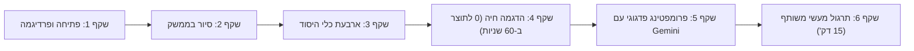
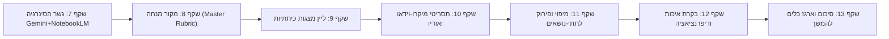

# תוכנית פדגוגית ומפרט טכני למצגת הדרכה אינטראקטיבית (HTML)
## סדנת תוצרים ממוקדים: NotebookLM ו-Gemini בחינוך
**מאת:** נתנאל – nt-school יזמות והדרכה (עוסק פטור)  
**קהל יעד:** מנהלים, מורים, רכזי מקצוע ומובילי פדגוגיה  
**משך הסדנה:** שעתיים אקדמיות (90 דקות נטו)  
**פורמט המצגת:** מצגת אינטראקטיבית מבוססת HTML5 עצמאית (Single-Page App) עם ניווט מקלדת, טיימר מובנה וחלונית העתקת פרומפטים בלחיצה.

---

## 1. רציונל פדגוגי וארכיטקטורת המפגש

### 1.1 המטרה הפדגוגית המרכזית
מעבר מתפיסת "בינה מלאכותית יוצרת הזיות" לתפיסת **"בינה מלאכותית מעוגנת מקור" (Grounded AI)**.  
המורים לומדים להשתמש בחומרי ההוראה הקיימים שלהם (ספרי לימוד, חוברות, קבצי PDF, מערכי שיעור) כבסיס ידע בלעדי, ומייצרים ממנו תוצרי כיתה מדויקים ודיפרנציאליים תוך דקות ספורות.

### 1.2 עקרון העבודה: Gemini + NotebookLM (The Workflow Bridge)
1. **Gemini:** כלי החשיבה, פירוק התוכן, ניסוח הפרומפטים ובניית התבניות הפדגוגיות.
2. **NotebookLM:** מעבדת התוכן המעוגנת שמבטיחה 0% הזיות מידע ו-100% נאמנות לתוכנית הלימודים.

---

## 2. מפרט טכני למצגת ה-HTML (Instructor Presentation Architecture)

המצגת תיבנה כקובץ HTML עצמאי בעל התכונות הבאות:
* **עיצוב תואם שפה מותגית:** ערכת נושא זכוכית נייבי-תכולה (Nordic Slate + Navy-Cyan Glass) התואמת את דף הנחיתה של nt-school.
* **ניווט גמיש:** חיצי מקלדת (`Space` / `→` / `←`), מספרי שקפים, ומצב מסך מלא (`F`).
* **חלונית פרומפטים בלחיצה אחת (`Click-to-Copy`):** לצד כל נושא, כפתור שמעתיק את הפרומפט המדויק ללוח של המורה בלחיצה אחת.
* **טיימר תרגול חי (Countdown Widget):** מוטמע בשקפי התרגול (10 דקות / 15 דקות) עם התראה קולית עדינה לסיום הזמן.
* **מסך מפוצל (Split Screen Demo):** חלון הדגמה המציג שלב-אחר-שלב של הממשק לצד תוצר ההוראה המוגמר.

---

## 3. תוכנית שקפים מפורטת – שעה ראשונה (45 דק')
### נושא: התחברות, הכרת הממשק ופיתוח תוצרים ראשונים



---

### שקף 1: פתיחה – למה AI רגיל נכשל בכיתה, ואיך NotebookLM פותר את זה?
* **מסר מרכזי:** המורה לא צריך לכתוב הכל מאפס. ה-AI צריך לקרוא את חומרי הלימוד המאושרים של משרד החינוך ולעבוד לפיהם.
* **תוכן השקף:**
  - הבעיה עם ChatGPT/Gemini כללי: "הזיות מידע", שפה מתורגמת מדי, אי-התאמה לסילבוס.
  - הפתרון: **NotebookLM** של גוגל – עובד אך ורק על המקורות שאתם מעלים (Grounding).
* **טיפ להנחיה (נתנאל):** שאל את המורים: *"כמה פעמים קיבלתם תשובה שנראתה נהדרת מה-AI, אבל כשבדקתם לעומק גיליתם עובדה היסטורית מומצאת?"*

---

### שקף 2: התחברות וסיור בממשק (The 3 Zones)
* **מבנה השקף:** צילום מסך אינטראקטיבי המדגיש את 3 אזורי העבודה:
  1. **עמודת המקורות (Sources):** העלאת PDF, Google Docs, סרטוני YouTube, קישורי אינטרנט וטקסט חופשי.
  2. **חלון השיחה המרכזי (Chat):** שאילת שאלות עם מראי מקום מדויקים (Citations).
  3. **לוח הסטודיו (Studio / Notebook Guide):** הפקת סיכומי עומק, שאלות מנחות, ציר זמן ותקציר שמע (Audio Overview).
* **הסבר טכני:** תמיכה של עד 50 מקורות למחברת, כל מקור עד 500,000 מילים.

---

### שקף 3: ארבעת כלי הפיתוח הנפרדים של NotebookLM
* **פירוט היחידות:**
  1. **Study Guide (מדריך למידה):** מייצר מילון מושגים, שאלות חזרה קצרות ושאלות חשיבה מסדר גבוה.
  2. **Briefing Doc (מסמך תדרוך):** סיכום מנהלים מהיר של הנושא עבור המורה לפני כניסה לשיעור.
  3. **FAQ & Study Questions:** מאגר שאלות ותשובות שכיחות של תלמידים.
  4. **Timeline (ציר זמן):** אידיאלי להיסטוריה, תנ״ך, ספרות ותהליכים ביולוגיים.

---

### שקף 4: הדגמה חיה של נתנאל – מ-0 לתוצר כיתה ב-60 שניות
* **חומר המקור:** פרק בנושא "חוקי ניוטון בחיי היומיום" (או טקסט הבנת הנקרא בעברית).
* **פעולה חיה במצגת:**
  - גרירת קובץ ה-PDF אל המחברת.
  - לחיצה על "Study Guide" -> הצגת התוצר המיידי.
  - הדגמת הציטוטים: לחיצה על מספר מראה מקום המקפיצה בדיוק לפסקה המקורית בטקסט.
* **תוצר מוגמר מוקרן:** דף כרטיסיות חזרה ושאלון הבנה אמריקאי מעוצב.

---

### שקף 5: פרומפטינג פדגוגי בעזרת Gemini
* **העיקרון:** איך מבקשים מ-Gemini להנדס פרומפט מושלם עבור NotebookLM?
* **נוסחת הפרומפטינג הפדגוגי:**
  `[תפקיד מומחה] + [קהל יעד וכיתה] + [מטרת הלמידה] + [מגבלות ופורמט פלט]`
* **חלונית פרומפט מוכנה להעתקה:**
  ```text
  פעל כמומחה פדגוגי להוראת [מקצוע] לכיתה [שכבה].
  בהתבסס אך ורק על המקורות שהועלו במחברת:
  1. נסח 5 שאלות רב-ברירה (אמריקאיות) ברמות חשיבה עולות (ידע, הבנה, יישום).
  2. לכל שאלה, ציין את התשובה הנכונה והסבר קצר מדוע המסיחים שגויים.
  3. השתמש בשפה פשוטה ובהירה המותאמת לגיל התלמידים.
  ```

---

### שקף 6: תרגול מעשי משותף (15 דקות) + טיימר פעיל
* **משימת המורים:**
  1. פתיחת מחברת חדשה ב-NotebookLM.
  2. העלאת מערך שיעור או קובץ טקסט קיים שהביאו איתם מהבית.
  3. הפקת תוצר ראשון: שאלון או דף חזרה בעזרת הפרומפט משקף 5.
* **במצגת:** טיימר 15:00 דקות רץ על המסך + רשימת בדיקה מהירה (Checklist) להצלחה.

---

## 4. תוכנית שקפים מפורטת – שעה שנייה (45 דק')
### נושא: שילוב Gemini + NotebookLM, תבניות מתקדמות ודיוק תוצרים



---

### שקף 7: גשר הסינרגיה – חלוקת תפקידים מדויקת
* **למה לא רק כלי אחד?**
  - **Gemini:** מצטיין בחשיבה רוחבית, יצירתיות, פירוק מושגים מורכבים וארגון מבני.
  - **NotebookLM:** שומר הסף – מוודא שאין סטיות, מייצר שאלות מבוססות טקסט מקור ומונע מידע שגוי.
* **זרימת העבודה:**
  1. מתחילים ב-Gemini לתכנון המבנה הפדגוגי.
  2. שופכים את התוצרים כמקור לתוך NotebookLM.
  3. מפיקים תוצרי קצה חיים לכיתה.

---

### שקף 8: יצירת "מקור הנחיה פדגוגי" (Master Source)
* **הסבר המתודה:** במקום לכתוב פרומפטים ארוכים שוב ושוב, מעלים ל-NotebookLM קובץ טקסט קצר שנקרא "הנחיות הוראה בית-ספריות" (למשל: דגשי שפה, מחוון משרד החינוך, עקרונות הנגשה).
* **התוצאה:** כל תוצר שיופק במחברת יעמוד אוטומטית בסטנדרט הפדגוגי של המורה.

---

### שקף 9: תבנית ממוקדת א' – ליין מצגות שיעור אחיד (Slide Deck Blueprint)
* **המטרה:** הפקת מצגת מובנית של 6-8 שקפים לכל יחידת לימוד.
* **חלונית פרומפט מוכנה להעתקה:**
  ```text
  צור מתווה למצגת שיעור בת 6 שקפים על בסיס הטקסט:
  שקף 1: שאלת פתיחה מסקרנת + תמונת המחשה מומלצת.
  שקף 2-3: מושגי המפתח עם הגדרות פשוטות ודוגמה מהחיים.
  שקף 4: תרשים זרימה או השוואה גרפית.
  שקף 5: דילמה לדיון בזוגות.
  שקף 6: משימת סיכום אישית קצרה.
  ```
* **דוגמה מוחשית שתוצג במצגת:** מצגת שלמה בנושא "המהפכה התעשייתית" המבוססת על פרק היסטוריה.

---

### שקף 10: תבנית ממוקדת ב' – מיקרו-וידאו וסיכומי אודיו (Audio Overview)
* **חלק א':** שימוש ביכולת ה-**Audio Overview** של NotebookLM (שיחת פודקאסט מעמיקה של שני מנחי AI על חומרי הלימוד).
* **חלק ב':** תסריט לסרטון טיקטוק/רילס לימודי קצר (60 שניות) שתלמידים אוהבים לצפות בו לחזרה למבחן.
* **דוגמה חיה:** השמעת קטע אודיו קצר בן 30 שניות שנוצר מהטקסט שהועלה בשעה הראשונה.

---

### שקף 11: מיפוי תוכן ופירוק לתתי-נושאים עם Gemini
* **הסבר הבעיה:** ספר הלימוד לעיתים עמוס ומסורבל.
* **הטכניקה:** מבקשים מ-Gemini למפות את הנושא ל-3 רמות עומק:
  - רמת בסיס (מושגי חובה לכל תלמיד).
  - רמת יישום (תרגול סטנדרטי).
  - רמת אתגר והרחבה (למתקדמים).
* הזנת המיפוי בחזרה ל-NotebookLM ליצירת דפי עבודה דיפרנציאליים מותאמים אישית.

---

### שקף 12: בחינת התוצרים בעין פדגוגית ביקורתית
* **צ'ק-ליסט בדיקה של המורה (The Teacher Audit):**
  1. האם השפה מתאימה לגיל התלמיד?
  2. האם יש מושגים שלא נלמדו ועלולים לבלבל?
  3. האם הניקוד והמחוון הוגנים וברורים?
* תרגול שיפור והידוק תוצרים בזמן אמת.

---

### שקף 13: סיכום, חלוקת מאגר הפרומפטים ושלב הבא
* **מה לקחנו היום?**
  - מחברת NotebookLM פעילה עם חומרי ההוראה האישיים של כל מורה.
  - לפחות 2 תוצרים מוכנים לשיעור הבא (שאלון / מצגת / כרטיסיות).
  - מתודולוגיית עבודה סדורה שחוסכת 3-5 שעות עבודה שבועיות.
* **קישור למאגר הכלים הדיגיטלי של nt-school ולסדנאות ההמשך המעשיות.**

---

## 5. מאגר פרומפטים מובנה להטמעה במצגת (Prompt Bank)

| שם התוצר | כלי מומלץ | פרומפט מוכן להעתקה |
|---|---|---|
| **כרטיסיות מושגים (Flashcards)** | NotebookLM | `חלץ מהמקורות 8 מושגי מפתח. לכל מושג הצג: שם המושג, הגדרה מדויקת ב-2 משפטים, ודוגמה מוחשית מחיי היומיום של תלמיד.` |
| **שאלון דיפרנציאלי** | Gemini -> NotebookLM | `בנה שאלון בן 6 שאלות: 2 שאלות זיהוי ידע בסיסי, 2 שאלות הבנה והסבר, ו-2 שאלות השוואה וניתוח. סמן תשובות נכונות.` |
| **מחוון הערכה למורה** | Gemini | `נסח מחוון הערכה בן 4 קריטריונים (תוכן, מבנה, שפה, חשיבה מקורית) לדירוג משימת הכתיבה, כולל ניקוד ברור מ-1 עד 100.` |
| **תסריט סרטון הסבר (60 שניות)** | NotebookLM | `כתוב תסריט לסרטון הסבר בן 60 שניות על הנושא. התסריט יכלול הוק פותח (3 שניות), הסבר עיקרי בשפה קולחת, וקריאה לפעולה.` |

---

## 6. תוכנית עבודה להטמעה ב-HTML
1. יצירת קובץ המצגת `notebooklm-workshop-presentation.html` בתוך פרויקט האתר.
2. חיבור סגנון הזכוכית והספרייה המקומית כדי שתוכל לפעול אופליין בכיתה ללא תלות ברשת.
3. הטמעת הטיימרים וחלוניות ההעתקה.
